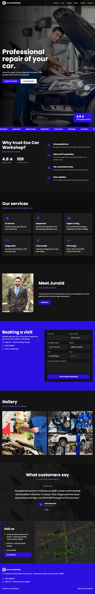
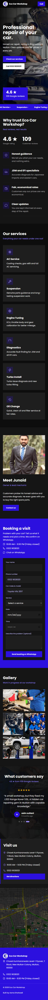

<div align="center">


# Eco Car Workshop

**A fast, responsive, single-page website for a car repair and tuning workshop in Multan, Pakistan.**

[](https://eco-car-workshop-next-js.vercel.app/)


</div>

---

## Preview

| Desktop | Tablet | Mobile |
| :---: | :---: | :---: |
|  |  |  |

---

## About

Eco Car Workshop is a trusted garage in New Multan Colony, rated **4.6 stars from 109 Google reviews**. Customers praise honest advice, fair prices and accurate diagnosis, especially on JDM and EFI cars.

This website turns that reputation into a clear online presence. A visitor can see the services, read real customer reviews, find the workshop on a map and book a visit in under a minute. All business details (address, phone, hours and reviews) come from the workshop's real public profile.

---

## Features

- **Booking system:** A complete form with name, phone, car model, service, date, time and problem notes. It validates every field, blocks past dates and Fridays (the workshop is closed), checks opening hours, and opens WhatsApp with the full request pre-filled.
- **Live review slider:** Real Google reviews rotate automatically, pause on hover and can be controlled with dots.
- **Click-to-call everywhere:** Every phone number is a tap-to-call link, and the address opens directions in Google Maps.
- **Custom dark map:** An OpenStreetMap embed restyled to match the brand, with a details panel beside it.
- **Smooth motion:** Hero entrance, floating rating badge, scrolling services strip, scroll reveals and hover effects. All animations switch off for users who prefer reduced motion.
- **API-driven content:** The page loads its data from its own `/api/business` endpoint.
- **Built for search:** Structured data, semantic markup and a verified, indexed Google Search Console property.
- **Mobile first:** The layout, navigation, form and slider are designed for small screens, not just shrunk to fit.

---

## Tech Stack

| Layer | Technology |
| --- | --- |
| Framework | Next.js 14 (App Router) |
| Language | TypeScript |
| UI | React 18, custom CSS design system |
| Icons | lucide-react |
| Font | Poppins via `next/font` |
| API | Next.js Route Handlers |
| Maps | OpenStreetMap embed |
| SEO | JSON-LD (`AutoRepair` schema), Google Search Console |
| Hosting | Vercel |

---

## Project Structure

```
eco-car-workshop/
├── app/
│   ├── api/business/route.ts   # Business data API
│   ├── globals.css             # Design system and styles
│   ├── layout.tsx              # Root layout, fonts, metadata, JSON-LD
│   └── page.tsx                # Single-page UI and components
├── lib/
│   └── data.ts                 # Business info, services and reviews
├── public/
│   ├── images/                 # Logo, hero, owner and gallery photos
│   └── google*.html            # Search Console verification
├── screenshots/                # README previews
└── package.json
```

---

## API

**`GET /api/business`** returns the workshop profile used by the page.

```json
{
  "name": "Eco Car Workshop",
  "phone": "0322 9028321",
  "address": "Chowk Kumharanwala Level-1 Flyover, T Block, New Multan Colony, Multan, 60000",
  "rating": 4.6,
  "count": 109,
  "hours": "10:00 AM – 9:30 PM (Friday closed)",
  "services": [{ "t": "Suspension", "d": "..." }],
  "reviews": [{ "n": "Customer name", "t": "Review text", "ago": "2 months ago" }]
}
```

---

## SEO

- Page title and meta description written for local search ("car repair Multan").
- **JSON-LD** structured data using the `AutoRepair` schema, including address, geo coordinates, opening hours and aggregate rating.
- Semantic HTML with one `h1` and a clear heading order.
- Descriptive `alt` text on all images and labelled form fields.
- Site ownership verified and pages indexed in **Google Search Console**.

---

## Design System

| Token | Value | Use |
| --- | --- | --- |
| Primary blue | `#2B10E0` | Buttons, accents, highlights |
| Soft violet | `#9D8CFF` | Sub-headings, icons |
| Charcoal | `#141414` | Page background |
| Card dark | `#1E1E1E` | Cards and panels |
| Typeface | Poppins (400 / 600 / 700) | All text |

---

## Getting Started

```bash
# 1. Clone the repository
git clone https://github.com/YOUR-GITHUB-USERNAME/eco-car-workshop.git
cd eco-car-workshop

# 2. Install dependencies
npm install

# 3. Start the development server
npm run dev
```

Open [http://localhost:3000](http://localhost:3000).

```bash
npm run build   # production build
npm run start   # run the production build
```

---

## Customising

- Edit business details, services and reviews in `lib/data.ts`. The page and the API both update from this one file.
- Replace the images in `public/images/` (keep the same file names).
- Change the review slider speed with `REVIEW_MS` at the top of `app/page.tsx`.

---

## Author

**Asma Shahzadi**: Full Stack Developer


